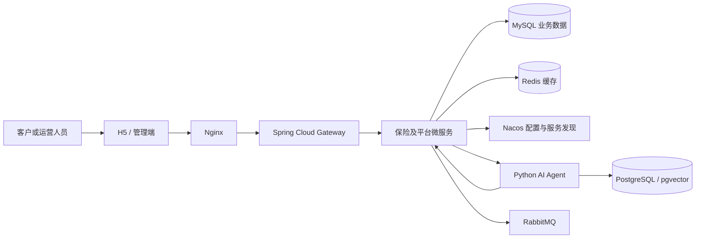

# Insurance Bridge（保顾通）

Insurance Bridge 是一个保险服务平台项目，包含客户侧 H5、运营管理端、Java 微服务后端和 Python AI Agent 服务。代码中的项目名、Java 包名仍保留 Bolee。

## 项目组成

| 目录 | 内容 |
| --- | --- |
| [`backend/`](backend/README.md) | Java 11 / Maven 多模块微服务，以及独立的 Python Agent 服务 |
| [`client/`](client/README.md) | 保险客户 H5、运营管理端的前端构建产物和 Nginx 配置 |

## 系统结构

客户请求由 Nginx 转发到 Gateway，再进入相应 Java 微服务。AI 客服由 Java 处理登录身份和业务接口访问，Python Agent 负责对话编排及工具调用；会话和 AgentOS 运行数据使用 PostgreSQL 保存。

## 运行依赖

- **Java 后端：** JDK 11、Maven、Spring Boot 2.7、Spring Cloud。服务发现和远程配置使用 Nacos。
- **业务基础设施：** MySQL 保存保险及平台业务数据；Redis 提供缓存等能力；RabbitMQ 支持异步消息；部分事务场景使用 Seata。
- **AI Agent：** Python 3.11 或更高版本、Agno / AgentOS、FastAPI、PostgreSQL（启用 pgvector 扩展）及所选模型服务的 API 凭据。
- **客户端：** Nginx 提供 H5 和管理端静态资源，并将 API 请求转发给后端服务。
- **按模块启用的组件：** XXL-JOB、Elasticsearch、Kibana、Logstash、InfluxDB 等，仅在对应任务、搜索或监控能力启用时需要。

Java、Python Agent 和前端是独立组件；只运行非 AI 业务时，不需要启动 Python Agent 和 AgentOS 数据库。
