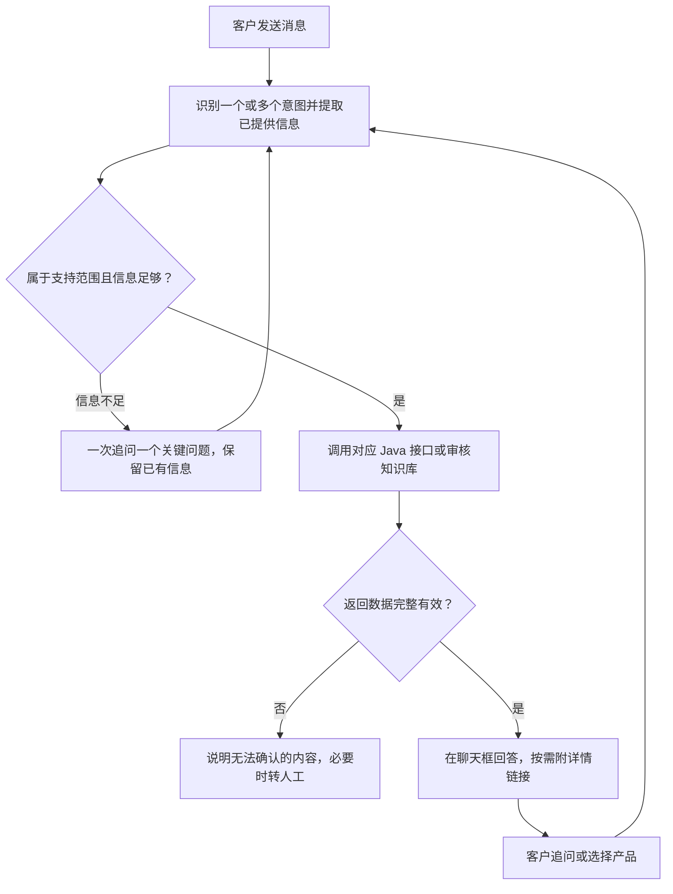

# 客服用户任务流程草案

**状态：需求草案 v1。**本文描述目标用户流程，不代表表中所有功能均已实现。客服以聊天框内回答为主；产品详情链接用于继续查看，不能替代聊天中的产品说明和比较结果。

## 通用对话流程

一条消息可以包含多个意图。例如“比较这两款，重点看多久生效”属于产品对比，并将生效时间作为对比维度；不要重复询问客户已提供的信息。

## 意图、信息与处理方式

| 用户意图 | 用户可能这样问 | 需要的信息 | 何时追问 | 何时转人工或正式流程 |
|---|---|---|---|---|
| **产品推荐** | “推荐一款适合团体运动的保险” | 产品类别或用途、个人/团体、关注点；具体条件以 Java 已发布的条件为准 | 类别不清楚，或推荐规则要求的必要条件缺失时，逐项追问 | 需求无法映射到已发布规则，或客户要求核保、承保结论时 |
| **产品查询** | “有哪些团体意外险？” | 类别、用途或客户主动提出的筛选条件 | 类别或产品名称有歧义时 | 目录不可用或返回信息不足以可靠回答时 |
| **产品对比** | “比较 A 和 B，哪个更适合我们？” | 要比较的产品；客户提出的关注点。未提出时使用固定的可核实维度 | 产品名称对应多个版本、比较对象不明确，或需求型比较缺少必要条件时 | 关键字段缺少审核数据时，标明无法确认；不得编造优劣结论 |
| **产品条款咨询** | “这款保险多久生效？哪些情况不赔？” | 产品及具体问题 | 产品不明确或有多个版本时 | 条款缺失、版本过期、责任或免责无法确认时 |
| **通用保险知识** | “什么是等待期？” | 通常只需问题本身 | 问题宽泛且需要结合某个产品时 | 涉及个案法律、医疗、承保或理赔判断时，不下结论并转专业渠道 |
| **本人保单咨询** | “我买的保险保多久、保费是多少？” | 已登录身份；有多份保单时需要选择具体保单 | 多份保单难以区分时，用产品名称等非敏感信息帮助选择 | 未登录、归属不能核验、数据冲突或查不到时；不在聊天里索取身份证号等敏感信息 |
| **理赔咨询** | “理赔需要什么材料？”、“我的理赔到哪一步？” | 一般流程只需问题；本人进度需要已核验身份及可定位的理赔记录 | 不清楚客户是问流程还是个人进度时 | 个人理赔数据未接入、身份不能核验或涉及理赔结论争议时 |
| **投保及保单售后流程** | “怎么买、怎么续保、怎么退保？” | 要了解的事项；涉及本人保单时需登录身份 | 不清楚客户是在了解流程还是要求办理时 | 解释流程并给官方入口；不代替客户投保、退保或变更保单 |
| **报价、核保或投保决定** | “我这种情况能不能承保？具体保费是多少？” | 正式报价/核保流程所需信息由相应业务系统收集 | 不在聊天中收集健康等非必要敏感信息 | 转正式报价或核保流程；Agent 不给承保结论、不代投保 |
| **申请人工客服** | “转人工”“我想找客服” | 原则上无需重复收集业务信息；可询问是否附带当前对话摘要 | 只有人工渠道需要选择时才询问 | 仅在人工转接能力真实可用时确认已转接；否则提供真实客服电话或平台入口 |
| **其他或暂不支持** | 闲聊、平台故障、未接入的业务问题 | 按需澄清 | 意图不清楚时问一个简短问题 | 多轮仍不清楚、超出权限或服务异常时，说明限制并提供可用入口 |

## 产品对比的聊天体验

客户指定产品后，Agent 在聊天框内给出简洁比较，通常包含共同点、主要差异、各自优势与限制，以及缺失或无法确认的字段。客户没有指定关注点时，可以先按保障内容、保障期限、生效条件和适用人群等可核实维度比较，再询问是否需要重点看某一项。价格只展示正式数据源返回的报价，不做估算。

每个产品可附一个详情页链接作为延伸入口。产品事实、对比数据和链接必须来自 Java 返回的数据或可信的产品 ID 映射；模型不得自行编造 URL。关键条款字段缺失时，应直接标注缺失，不把它包装成优劣结论。

## 追问与转人工规则

- 只追问完成当前任务所必需的信息，一次问一个关键问题，并保留本轮和前文已提供的内容。
- 用户表达含糊时，先澄清目标或优先级；不得把“尽快生效”等模糊说法擅自转换成具体天数。
- 资料缺失、版本冲突、身份校验失败、业务接口不可用或多轮澄清后仍无法安全处理时，说明具体无法确认之处，并在转接能力可用时转人工。
- 不把“想了解流程”当成“授权执行操作”；不执行核保、承保、支付、投保、退保或理赔提交。

## 当前实现边界

- **已验证：** Python 可通过授权客户端调用 Java 产品分类和按分类查询接口，并解析返回结果。
- **已有代码、需业务数据发布后验证：** 个性化产品推荐条件与规则链路。没有审核发布的数据时，不应返回真实推荐结论。
- **尚待接口或资料接入：** 审核版产品条款、完整对比事实及详情链接、本人保单、理赔、正式报价和人工转接。

功能是否已落地，以 [Agent 功能范围与当前状态](agent-capabilities.md) 和当前代码为准；本文是用户流程目标，不构成功能已实现的证明。
