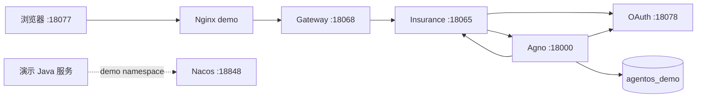

# AI 客服开发与演示环境约定

开发和演示都运行在这台 Windows 电脑上。两套应用使用不同的端口和数据命名空间；资源紧张时按需启动，演示不再要求另一台主机。

## 环境隔离

| 项目 | 开发 | 本机演示 |
| --- | --- | --- |
| Java | 现有开发端口（如 Insurance 17065、Gateway 17068/17069） | 独立端口 180xx |
| Nacos | `public` namespace | `bolee-demo` namespace，服务发现和配置均独立 |
| MySQL | 原开发 schema | `demo_bolee-*` schema，仅复制表结构，不复制客户数据 |
| Redis | 开发使用的 DB | Redis DB 1 |
| RabbitMQ | 开发 vhost/user | `/bolee-demo` vhost 和独立 user |
| AgentOS | 现有 Postgres 服务和开发 database | 同一 Postgres 容器内的 `agentos_demo` database |
| Agno | 开发容器/端口 | demo Compose project 的独立容器，宿主机仅监听 `127.0.0.1:18000` |
| H5 / 管理端 | `18177` / `18166` | `18077` / `18086` |

Nacos、MySQL、Redis、RabbitMQ、Seata 和 AgentOS PostgreSQL 复用已经运行的本机基础设施，不额外启动第二份重型数据库或 Nacos。演示 Java、Agno、Nginx 由独立启动状态和端口管理；数据库账号只授权访问 demo schema。演示数据从空 schema 开始，禁止导入开发客户数据。

## 固定请求链路



浏览器入口为 `http://127.0.0.1:18077/ai-chat.html`，管理端为 `http://127.0.0.1:18086/`。Agno 容器访问宿主机 Java 时使用 `host.docker.internal`。演示进程使用 `-Xmx512m` 上限，避免和开发套件争用过多内存。

## 配置与启动

`.env.demo` 是本机忽略文件，不能提交。当前已配置演示专用数据库、RabbitMQ、OAuth/签名材料、AgentOS database 和模型 API 凭据。需要更新凭据时只修改此文件或密钥库，不要写入 Nacos 明文常量或 Git。 `AGNO_OPERATOR_OAUTH_CLIENT_ID` 必须与 `AGNO_OPERATOR_CLEANUP_OAUTH_CLIENT_ID` 相同，确保 Java 清理调用与 AgentOS 授权校验使用同一专用身份。

演示 Nacos 配置从本地开发配置克隆后转换成 demo schema、凭据占位符、端口、Redis DB 和 OAuth/Agent 地址。改动开发配置后，运行：

```powershell
python deploy/demo/provision_nacos.py
```

首次运行安装客户端初始化脚本依赖：

```powershell
python -m pip install -r deploy/demo/requirements.txt
```

`start-local.ps1` 在启动 Java 服务前会幂等校验 Nacos 中 Gateway 的本地前端 CORS 来源：开发版使用 H5 `18177`、管理端 `18166`；演示版使用 `.env.demo` 中的 `DEMO_H5_PORT`、`DEMO_ADMIN_PORT`。两种环境都允许 `127.0.0.1` 和 `localhost`。这样重新克隆或恢复 Nacos 配置后，不会因本地页面来源漏配而让浏览器登录请求被 CORS 拦截。

启动整套本机演示服务：

```powershell
.\start-local.ps1 -Environment demo -Mode Demo -IncludeAgentOS -NginxRoot 'D:\Code\bolee-cloud-nginx'
```

开发环境启动仍使用 `-Environment dev`；脚本用不同状态文件，停止其中一套不会停止另一套 Java/Nginx 进程。演示启动不会运行开发基础设施 bootstrap，也不会更改开发 Nacos namespace。

停止演示应用：

```powershell
.\stop-local.ps1 -Environment demo
```

这会停止 demo Java、Nginx 进程；不会停止共享的基础设施，也不会删除数据库。加 `-StopAgentOS` 会停止独立 demo Agno 容器，但保留数据库。

## 验收

启动脚本会幂等配置四个独立机器 OAuth 客户端，并使用 Java 实际采用的 BCrypt 编码凭据。启动后核验 `bolee-demo` 中七个 Java 服务、Agent `/health`、H5/管理页 `/healthz` 和保险文档页。演示 schema 不复制客户数据，目前没有演示账号和产品；真实登录聊天验收前还需加入合成账号与保险产品数据。
